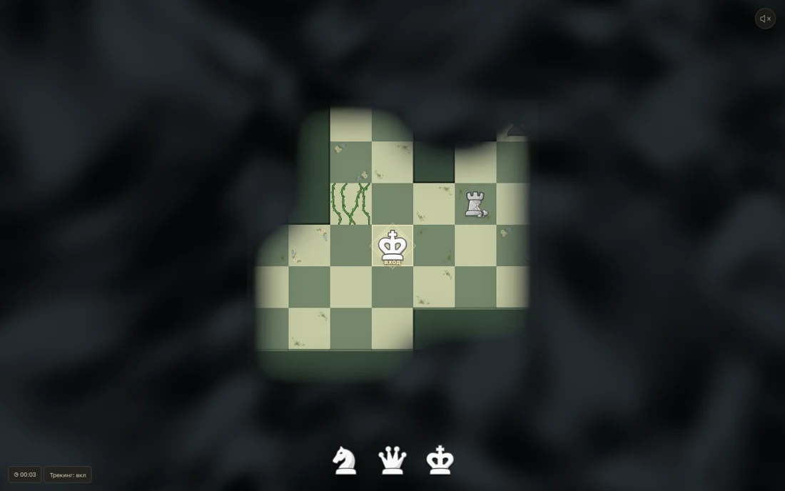
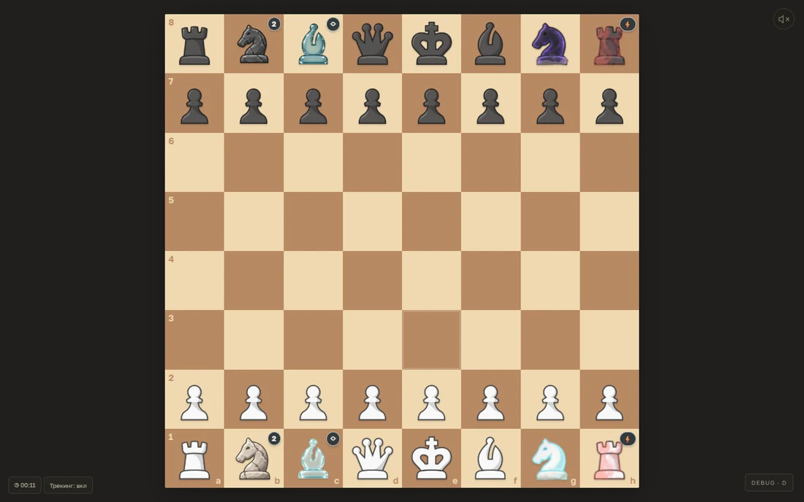

<p align="left"></p>

# Chess Dungeons

Браузерный шахматный рогалик. Исследуйте подземелья, собирайте отряд и артефакты, расставляйте фигуры и сражайтесь с противниками. Есть и классические шахматы для двоих или против Stockfish.


[Играть в Chess Dungeons](https://fresh-milkshake.github.io/chess-dungeons/dungeon.html) · [Классические шахматы](https://fresh-milkshake.github.io/chess-dungeons/)

| Подземелье | Бой |
|:---:|:---:|
|  |  |

## Запуск

Node.js 22.12+ и Emscripten. В Windows для сборки движка используется Ubuntu в WSL.

```sh
npm ci
npm run build:lab
npm run build
npm run dev
```

Кампания открывается на `/dungeon.html`. На карте WASD или стрелки двигают короля, Enter подтверждает действие, колесо меняет масштаб.

Проверки и сборка сайта · `npm test` · `npm run test:lab` · `npm run build:pages`.

[Устройство кампании](docs/DUNGEON-DESIGN.md) · [Движок и сборка](engine/README.md) · [Документация игры](docs/)

## Автор и лицензия

[fresh-milkshake](https://github.com/fresh-milkshake) · [GPL-3.0-or-later](LICENSE).

Движки · [Fairy-Stockfish и патчи](engine/) · [Stockfish.js 19.0.1 и исходники](https://github.com/nmrugg/stockfish.js/releases/tag/v19.0.1). [Лицензия chess.js](public/licenses/chess-js-BSD-2-Clause.txt).

У материалов свои правообладатели и условия · [фигуры Neo](public/pieces/ATTRIBUTION.md) · [звук хода](public/sounds/ATTRIBUTION.md) · [музыка](public/audio/CREDITS.md) · [шрифты](public/fonts/cormorant-sc/OFL.txt).
